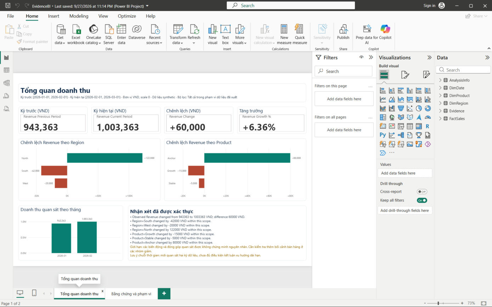

# Evidence-Driven AI BI Analyst

A local-first analytics system for explaining observed Revenue changes with explicit scope, traceable evidence, deterministic validation, and a Power BI PBIP report artifact. The flagship contract is frozen in [`docs/FLAGSHIP_EXECUTION_PLAN.md`](docs/FLAGSHIP_EXECUTION_PLAN.md); public evidence is indexed in [`docs/RELEASE_EVIDENCE_INDEX.md`](docs/RELEASE_EVIDENCE_INDEX.md).



## In short

Ask an LLM why revenue changed and it will answer fluently, sometimes with numbers or causes it
made up. This project is an analytics assistant built so that it cannot do that.

- **The model never computes.** It can only submit one structured action at a time (forced function
  calling, strict JSON schema) choosing among three read-only tools: `aggregate_metric`,
  `compare_periods`, `breakdown_change`. Python computes every number.
- **Every finding is checked before it is shown.** A deterministic validator ties each statement to
  evidence IDs and to the confirmed scope; unsupported statements are dropped or reported as limits.
- **It declines what the data cannot support.** Causal "why" questions (English and Vietnamese)
  get an explicit abstention instead of an invented reason.
- **The result is exported as a Power BI project** (PBIP/TMDL), and the report's DAX is reconciled
  against the Python results.

```
CSV ─► profile + human-confirmed semantics ─► bounded agent ─► 3 deterministic tools
                                                   │                    │
                                                   ▼                    ▼
                              validated findings + limits ◄── evidence store
                                                   │
                                     Streamlit UI  ·  Power BI report (PBIP)
```

## Results

| Check | Result |
|---|---|
| Automated tests | 440 passed, 2 skipped (Windows symlink privilege) |
| Live LLM evaluation (OpenAI API, fixed budget cap) | tool choice 81/81 · tool numbers 276/276 · required abstention 6/6 · unsupported claims 0/81 |
| Measured LLM cost of that evaluation | about $0.03 (cap $4.50) |
| Power BI vs Python reconciliation | 7/7 DAX contexts, 35 values |

**Two modes.** The Streamlit app runs the deterministic Python pipeline (no LLM call, works
offline). The LLM agent is a separate, opt-in mode run from the CLI and the evaluation harness; it
was evaluated on its own and is not switched on in the app UI.

The live evaluation uses a small synthetic scenario set; it shows the guardrails hold on those
cases, not that the agent is correct in general. Details and hashes:
[`docs/RELEASE_EVIDENCE_INDEX.md`](docs/RELEASE_EVIDENCE_INDEX.md).

**Stack:** Python 3.12, Pydantic, Pandas, httpx, OpenAI Responses API, Streamlit, Power BI
(PBIP, TMDL, DAX), Pytest, Ruff, GitHub Actions.

**Where to look:** agent loop and guardrails in [`src/bi_analyst/runtime.py`](src/bi_analyst/runtime.py)
and [`provider.py`](src/bi_analyst/provider.py) · deterministic tools in
[`analytics.py`](src/bi_analyst/analytics.py) · claim validation in
[`finding_validation.py`](src/bi_analyst/finding_validation.py) · Power BI export in
[`bi.py`](src/bi_analyst/bi.py) · failure modes in
[`docs/SECURITY_AND_FAILURE_MODES.md`](docs/SECURITY_AND_FAILURE_MODES.md).

**Development note:** built with AI coding assistants under a written plan, with independent review
passes and tests required before each step was accepted; the planning and review records are kept in
[`docs/`](docs/).

---

## Business Question & Observed Findings

> **Business Question**: Did observed Revenue change between the baseline period `2026-01-01` to `2026-02-01` and the comparison period `2026-02-01` to `2026-03-01`, and how do Region and Product segment movements account for that change?

Native screenshots are kept as verification records and are not presented as proof for a different generated revision.

### Three Observed Facts (Synthetic Demonstration)

1. **Overall Revenue Growth**: Total observed revenue increased from **943,363 VND** to **1,003,363 VND**, representing a net change of **+60,000 VND** (+6.36%).
2. **Regional Divergence**: The **North** region expanded by **+122,000 VND**, which was partially offset by contractions in **South** (**−42,000 VND**) and **West** (**−20,000 VND**), exactly accounting for the +60,000 VND net movement.
3. **Product Composition**: The **Anchor** product drove **+80,000 VND** in growth, while **Growth** (**−15,000 VND**) and **Stable** (**−5,000 VND**) softened, reconciling to the identical +60,000 VND delta.

### Analytical Limitation

> [!WARNING]
> **No Causal Claim**: Observed accounting contributions do not establish external causation, price elasticity, marketing effectiveness, or long-term trends. As noted on the dashboard: *mới quan sát hai kỳ dữ liệu, chưa đủ điều kiện kết luận xu hướng dài hạn*. Further investigation requires domain context.

---

## Local Quick Start

Requires Python 3.12+ on Windows PowerShell. Runs completely local and offline with zero cloud LLM or telemetry calls.

### 1. Setup Environment

```powershell
py -3 -m venv .venv
.\.venv\Scripts\python.exe -m pip install -r requirements.lock
```

### 2. Run Test Suite & Linter

```powershell
.\.venv\Scripts\python.exe -m pytest -q --tb=short
.\.venv\Scripts\ruff.exe check .
```

*Status (2026-10-02)*: **440 passed, 2 skipped** (Windows symlink privileges documented), **0 failed**. All Ruff checks passed.

### 3. Launch Local UI (Streamlit)

```powershell
.\.venv\Scripts\python.exe -m streamlit run app.py --server.address 127.0.0.1 --browser.gatherUsageStats false
```

---

## Power BI report

Open [`deliverables/PowerBI_Demo_Refresh_R19_allcorrect_scopeinvert_tmdl/EvidenceBI.pbip`](deliverables/PowerBI_Demo_Refresh_R19_allcorrect_scopeinvert_tmdl/EvidenceBI.pbip) in Power BI Desktop and press Refresh. The model loads embedded data; no cloud connection is needed.

The report is a PBIP project (PBIR report + TMDL semantic model) generated by [`src/bi_analyst/bi.py`](src/bi_analyst/bi.py). Its DAX results were reconciled against the Python results (7/7 contexts, 35 values), and both pages were checked in Power BI Desktop, including click interactions. Second page: [evidence and scope](deliverables/verification/dashboard_refresh_r3/media_r19_20260929/r19_page2_evidence_scope.jpg).

The Streamlit UI was also walked through in a browser: analysis and export, the confirmation guard, and abstention on causal questions in English and Vietnamese. Full records for both: [`docs/VERIFICATION_NOTES.md`](docs/VERIFICATION_NOTES.md).

## Known limitations

- The causal-question gate is keyword-based: some rephrasings are not caught, and a few descriptive questions containing the same words are declined (fail-safe).
- The live evaluation covers a small synthetic scenario set.
- On page 2 of the report, long table cells are truncated.


---

## Scope & Boundaries

- **Single Additive Metric**: Supported exclusively for `Revenue`.
- **Two Explicit Periods**: Non-overlapping baseline and comparison intervals.
- **Fixed Dimensions**: `Region` and `Product`.
- **Bounded Deterministic Tools**: Analytical agent calls strictly 3 deterministic read-only tools; no arbitrary free-form code execution or dynamic layout hallucination.
- **Application LLM Policy**: Default is `OFF`/`local_only`. External cloud API calls are disabled.

For the public evidence map and current release limitations, refer to [`docs/RELEASE_EVIDENCE_INDEX.md`](docs/RELEASE_EVIDENCE_INDEX.md).
